

  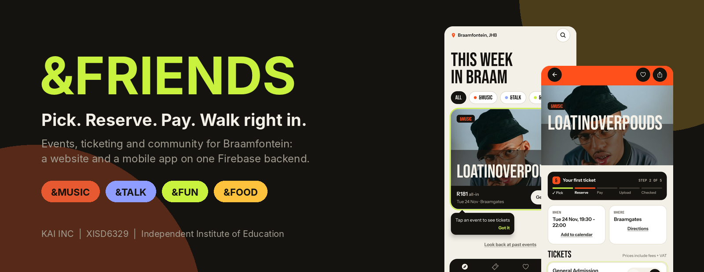

  
  
  
  
  
  

# &FRIENDS: website and mobile app

> **Pick. Reserve. Pay. Walk right in.**
> A full-stack events and ticketing platform for the &FRIENDS creative community space in Braamfontein, Johannesburg: a responsive website and a mobile app that share one Firebase backend.

Built by **KAI INC** for the Independent Institute of Education (IIE) Work Integrated Learning module **XISD6329**.

## Contents

1. [Quick links](#-quick-links)
2. [Purpose of the app](#-purpose-of-the-app)
3. [Screenshots](#-screenshots)
4. [Features](#-features)
5. [Design considerations](#-design-considerations)
6. [How it all fits together](#-how-it-all-fits-together)
7. [Tech stack](#-tech-stack)
8. [How we used GitHub](#-how-we-used-github)
9. [GitHub Actions and CI/CD](#-github-actions-and-cicd)
10. [Testing and quality](#-testing-and-quality)
11. [Run it yourself](#-run-it-yourself)
12. [Release notes](#-release-notes)
13. [Team](#-team)
14. [Known limitations](#-known-limitations)
15. [License](#-license)

## 🔗 Quick links

| What | Link |
|---|---|
| Live website | [friends-h52a.vercel.app](https://friends-h52a.vercel.app/andfriends/html/index.html) |
| Mobile app repository | [github.com/42seconds/friends-app](https://github.com/42seconds/friends-app) |
| Website repository | [github.com/Kgahlisho/-FRIENDS](https://github.com/Kgahlisho/-FRIENDS) |
| Azure DevOps board | [dev.azure.com/ST10448302/FRIENDS-App](https://dev.azure.com/ST10448302/FRIENDS-App) |
| Release notes | [RELEASE_NOTES.md](RELEASE_NOTES.md) |
| Video walkthrough (with voice-over) | **TODO: add your YouTube (unlisted) link here** |
| Android APK | **TODO: add the link to the APK build artifact or release** |

## 🎯 Purpose of the app

&FRIENDS hosts music nights, talks, game nights and food markets. Before this project its only online presence was social media, which caused three real problems:

| Problem | What it meant |
|---|---|
| **Scattered information** | Events lived on Instagram and WhatsApp. There was no central hub, no full brand story and no data the business owned. |
| **Manual EFT checks** | Ticket sales were paid by EFT. Staff checked every proof of payment by hand and tracked guests on paper. |
| **No certainty** | Guests paid, then waited, unsure their ticket was secured. Chasing it up cost staff time and cost sales. |

**Our answer** is two connected products on one backend:

- **The website** is the brand's home and the admin control centre: brand pages, live events, ticket booking, venue hire and dashboards for customers and admins.
- **The mobile app** is for the night itself: guests browse events, reserve tickets, pay by EFT, upload proof and get a QR ticket. Door staff use the same app to approve payments, run the guest list and scan tickets.

**Goals**

1. Give &FRIENDS one trusted place for its brand, events and bookings.
2. Make EFT payments clear and trackable for guests and staff.
3. Make entry on the night fast and reliable.
4. Give admins the tools to manage events, payments, users and reports.
5. Handle user data and authentication securely.
6. Show good software engineering: version control, CI/CD and automated tests.

## 📸 Screenshots

### Mobile app

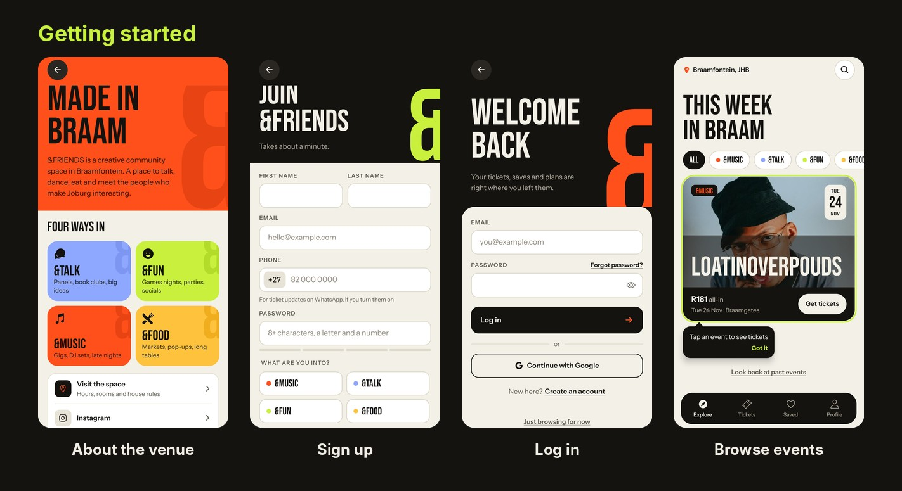
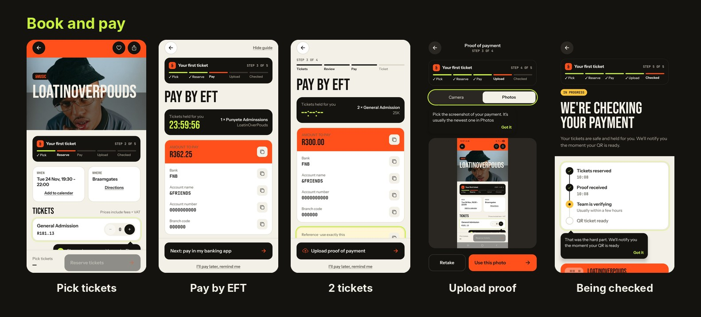
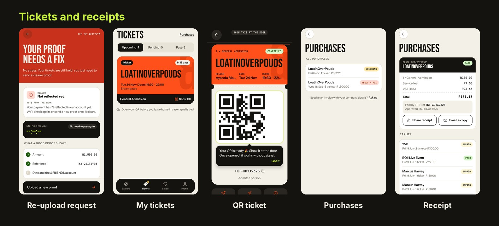
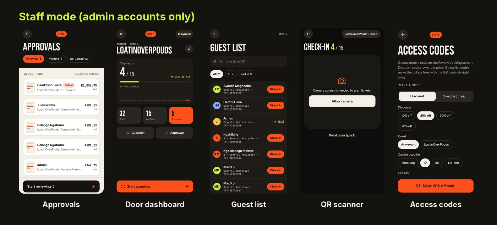
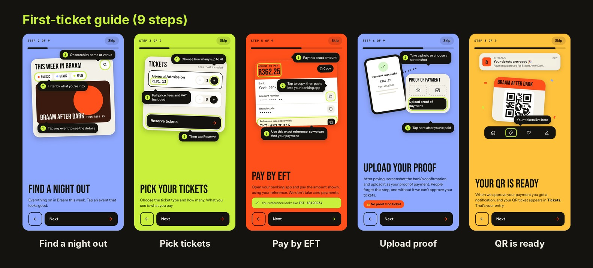
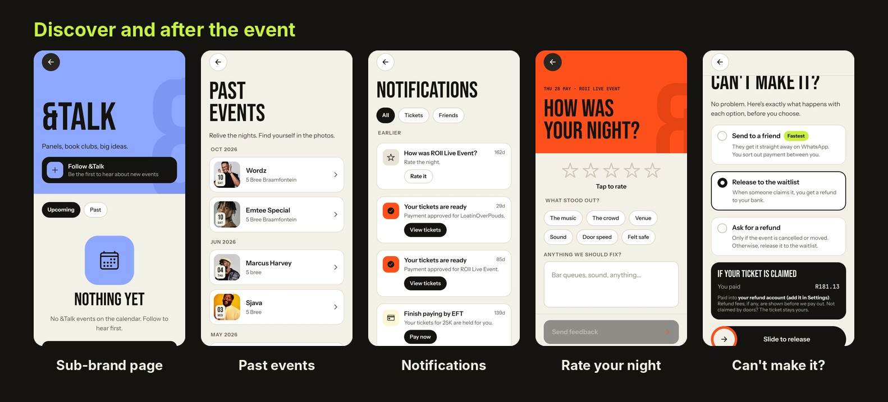
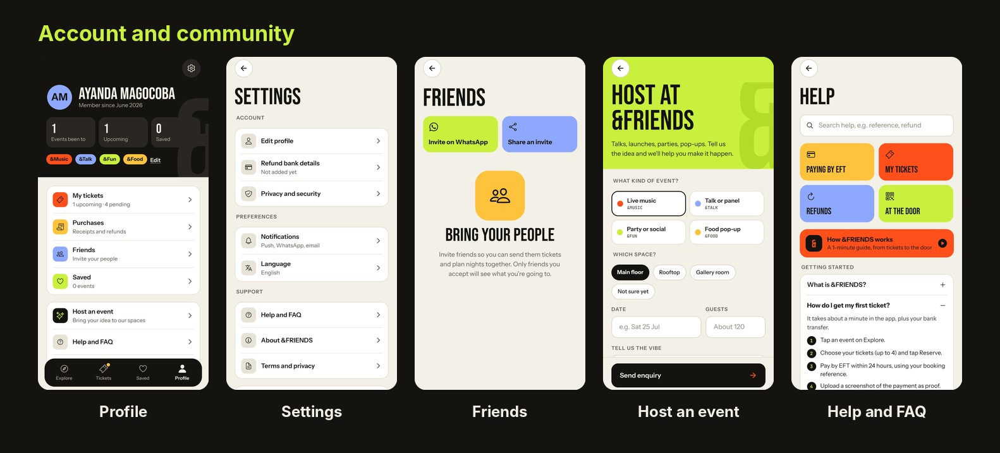

### Website

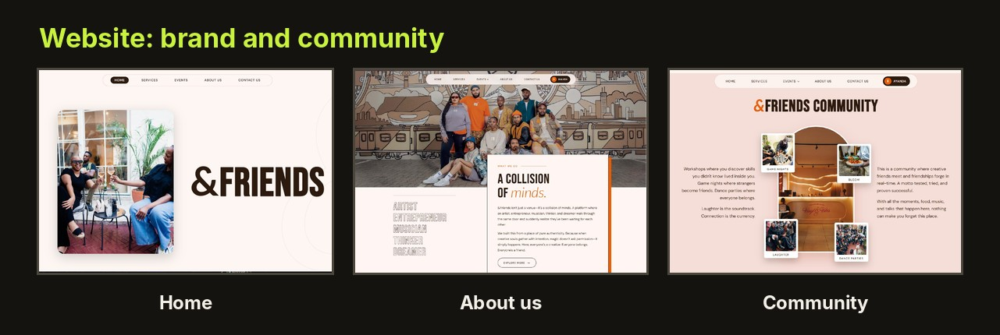
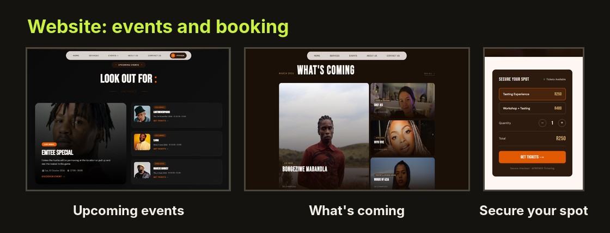
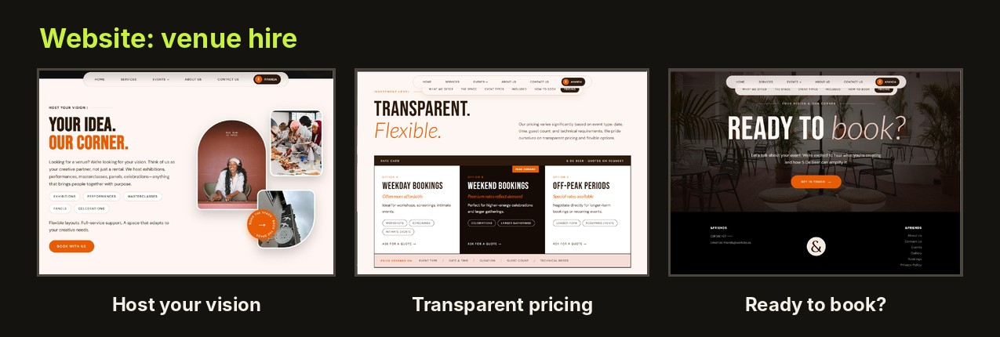
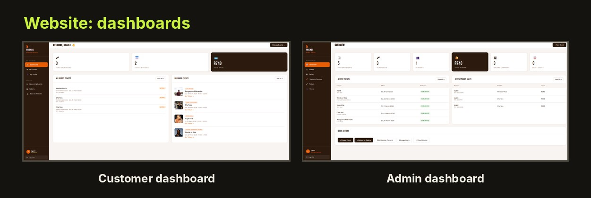

## ✨ Features

### For guests (mobile app)

- **Sign up and log in** with Firebase Authentication, and choose the sub-brands you are into.
- **Explore** what is on this week, with search and filters (when, price, sub-brand, free events only).
- **Event pages** with lineup, location map, route to the venue and photo galleries.
- **Book and pay by EFT**: pick tickets, hold them for 24 hours, pay with a unique reference, upload proof and follow the status.
- **QR tickets** that work offline, with receipts and purchase history.
- **Flexible tickets**: send a ticket to a friend, release it to the waitlist or ask for a refund.
- **Community**: friends, who is going, host-an-event enquiries and post-event ratings.
- **Help** when you need it, including a replayable 9-step first-ticket guide.

### For staff and admins

- **Approvals queue** with proof review and reject-with-reason.
- **Door mode**: live check-in counts, guest list, manual ticket entry and a QR scanner with five clear results.
- **Access codes** for discounts and guest lists.
- **Website admin dashboard**: create events with ticket tiers, upload gallery images, see sales and revenue, and manage website content, tickets and users.

### Website

Home, Services (venue hire with a rate card), Events, About us, Community, Contact us, customer and admin accounts, ticket booking, and customer and admin dashboards. It works on desktop and mobile browsers.

## 🎨 Design considerations

### 1. Brand and visual system ("Braam Night+")

The app uses a dark theme with bold condensed type and one colour for each sub-brand, so a guest recognises where they are at a glance.

| Sub-brand | Colour | Used for |
|---|---|---|
| &Music | Orange | Gigs, DJ sets, late nights |
| &Talk | Blue | Panels, book clubs, big ideas |
| &Fun | Lime | Games nights, parties, socials |
| &Food | Yellow | Markets, pop-ups, long tables |

The website uses a warmer palette (cream, blush and dark brown with orange accents) to suit a browsing experience on larger screens.

### 2. Information architecture

The app has four bottom tabs (Explore, Tickets, Saved, Profile). Booking is one clear path from Explore to the QR ticket. Admin accounts also get a staff mode. We planned this with sitemaps and wireframes before building.

[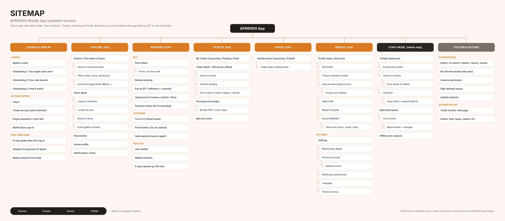](docs/images/design/app_sitemap.png)

*Updated mobile app sitemap (click to enlarge).*

### 3. Design principles we followed

| Principle | How it shows up |
|---|---|
| **Design for the first-time buyer** | A 9-step guide, one-time coach-mark bubbles and a guided first payment teach EFT on the real screens. |
| **Always show the payment status** | A timeline shows reserved, proof received, team verifying and QR ready. |
| **Be forgiving** | Tickets are held for 24 hours, a rejected proof can be re-uploaded without paying again, and log-out has a chance to cancel. |
| **Keep interruptions low** | Prompts appear once, guide steps can be skipped or hidden, and the notification request is one optional step. After our presentation feedback we also split long tasks, such as the EFT screen, into short steps. |
| **Work when signal is bad** | Tickets and recent events open offline. |
| **Make staff fast** | Oldest approvals first, a proof checklist, and five unmistakable scan results at the door. |
| **Keep users safe** | Roles are enforced in the database and tested automatically. |

### 4. Wireframes

We designed in low-fidelity first, so the team agreed on layout and hierarchy before styling.

[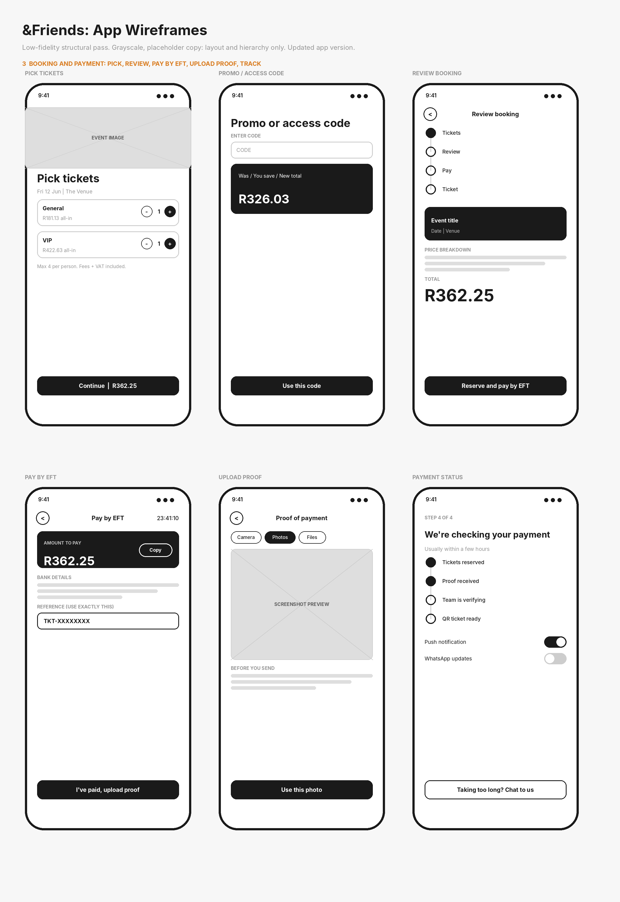](docs/images/design/app_wireframes_3_booking.png)

*All wireframe sheets are in [`docs/images/design`](docs/images/design): onboarding, discovery, booking, tickets and profile, staff mode, outcomes and community, plus three website sheets.*

[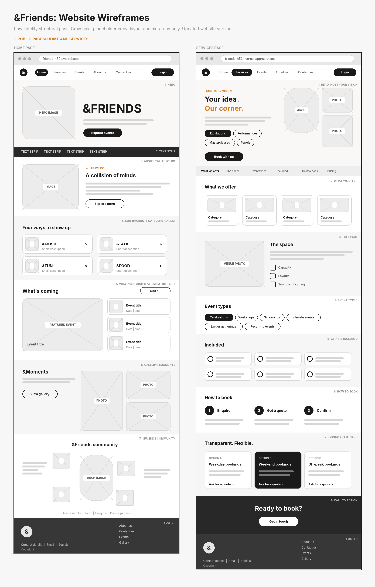](docs/images/design/website_wireframes_web_1_public.png)

### 5. Security and data design

- **Authentication:** Firebase Authentication, with email verification and password reset.
- **Authorisation:** Firestore security rules separate guest and admin roles. Admin accounts register with an access code.
- **Proof of payment:** uploaded proofs are stored with Firebase Storage and are only reviewed by staff.
- **Tested rules:** 53 automated tests check the rules on the Firebase emulator.

## 🧩 How it all fits together

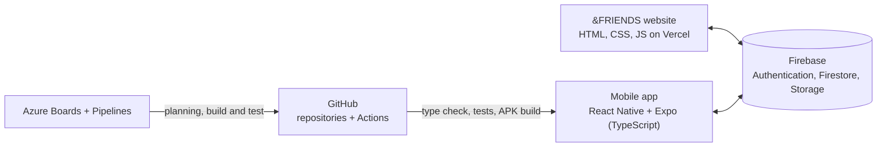

One booking, end to end:

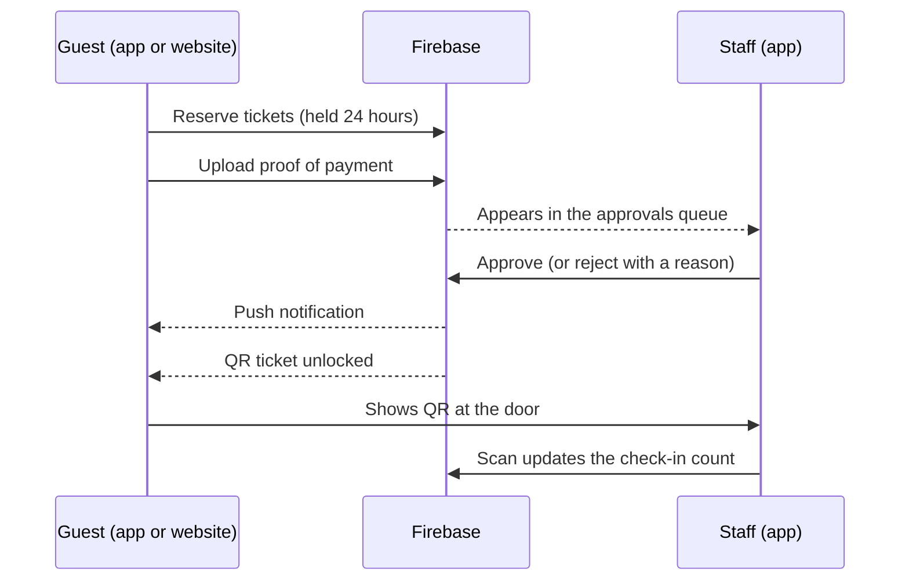

## 🛠 Tech stack

| Area | Technology |
|---|---|
| Mobile app | React Native, Expo, TypeScript |
| Website | HTML5, CSS, JavaScript, hosted on Vercel |
| Back end | Firebase Authentication, Cloud Firestore, Firebase Storage |
| Testing | Jest (unit tests), Firestore emulator (security-rules tests) |
| CI/CD | GitHub Actions, Azure Pipelines |
| Planning | Azure Boards (epics, features, user stories, sprints) |
| Design | Figma, Draw.io, Visual Paradigm |
| Tools | Git and GitHub, Visual Studio Code |

## 🐙 How we used GitHub

GitHub is our central version-control platform, and the evidence of our teamwork.

**Repositories**

| Repository | Contains |
|---|---|
| [`42seconds/friends-app`](https://github.com/42seconds/friends-app) | The mobile app, its tests, the GitHub Actions workflows, `azure-pipelines.yml` and the Azure Boards backlog files in `docs/azure-devops` |
| [`Kgahlisho/-FRIENDS`](https://github.com/Kgahlisho/-FRIENDS) | The website (HTML, CSS and JavaScript) and its Vercel deployment settings |

**How we worked**

- **Branch strategy:** `master` always holds working code. New work happens on feature branches (for example `feature/braam-night`) and is merged back through a pull request once the checks pass. The final release is merged to `master` and tagged.
- **Commits:** small, regular commits with meaningful messages, pushed often so progress is always visible.
- **Linked work:** commits and pull requests that mention `AB#<id>` link to their work item in Azure Boards through the Azure Boards GitHub App.
- **Planning:** 9 epics, features and user stories (91 work items in total) across seven two-week sprints, from 21 July to 26 October 2026.
- **Reviews:** changes are reviewed before they are merged, and we keep the agreed folder structure and avoid duplicate files.

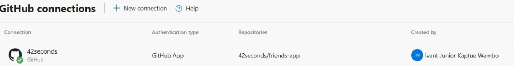

Planning evidence: kanban board, sprints and backlog

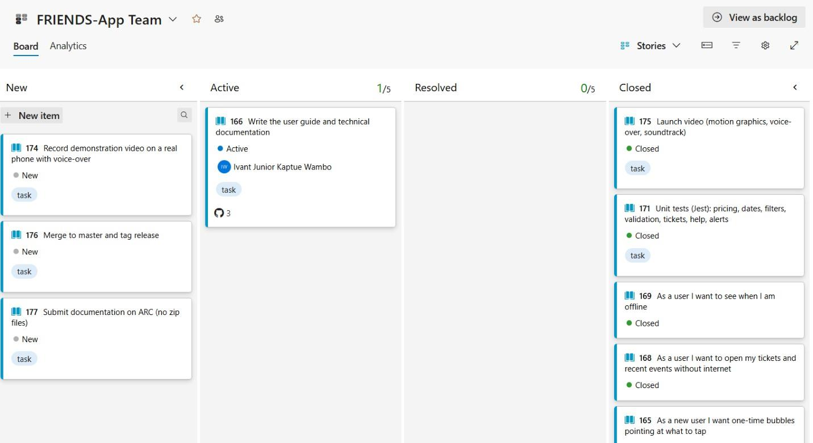
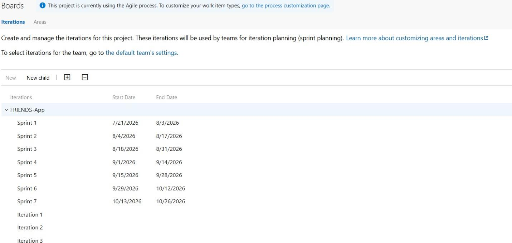
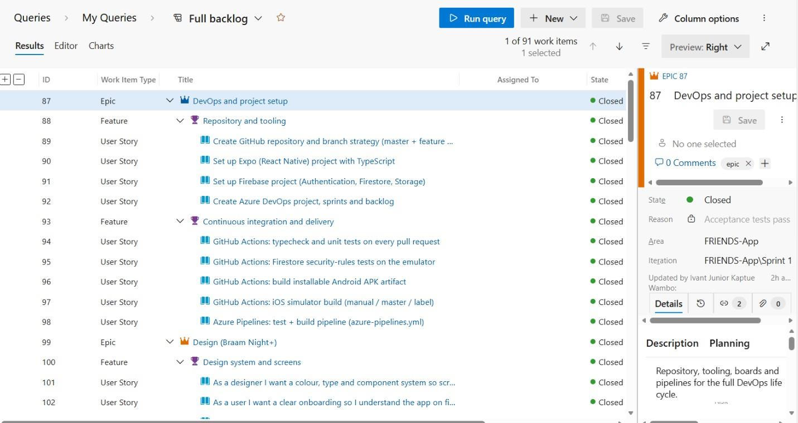

## ⚙️ GitHub Actions and CI/CD

Every change has to pass automated checks before it reaches `master`.

| Workflow | What it does | Result |
|---|---|---|
| **Type check and unit tests** | Runs the TypeScript type check and the Jest unit tests on every pull request. | A pass or fail status on the pull request |
| **Firestore security-rules tests** | Runs the 53 rules tests against the Firebase emulator. | Confirms guests cannot do admin actions |
| **Build Android APK** | Builds an installable Android app. | An APK saved as a build artifact |
| **iOS simulator build** | Builds the iOS version for the simulator. It is started manually, on `master` or by a label. | A simulator build |

The workflow files are in `.github/workflows` in the app repository.

**Azure Pipelines** (`azure-pipelines.yml`) does the same job in two stages, *Type check and tests* and *Build Android APK*. Run `#20261018.1` on `feature/braam-night` passed 100% of its tests and published the installable APK in 33 minutes.

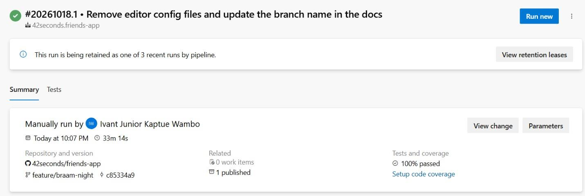
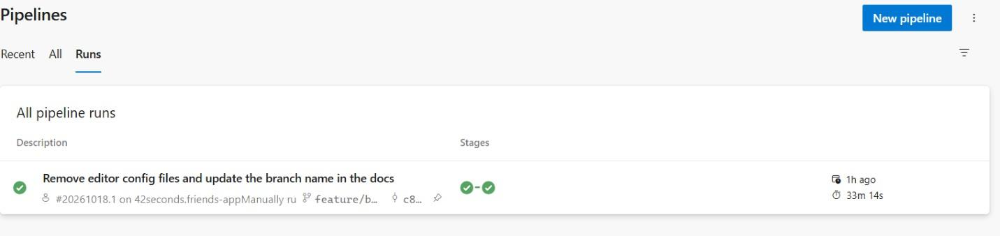

**Why this matters:** bugs are caught before they reach the main branch, the access rules cannot be broken without a failing test, and a tested APK is always available to install and demo.

## ✅ Testing and quality

| Type | What it covers |
|---|---|
| **Unit tests (Jest)** | Pricing, dates, filters, input validation, tickets, help and alerts |
| **Security-rules tests** | 53 tests for guest and admin permissions on the Firestore emulator |
| **CI checks** | Type check and tests on every pull request, and on the Azure pipeline |
| **Manual testing** | Navigation, links, forms and input, user interaction, responsive layouts, booking and events, authentication, database and back end, error and bug tracking, and cross-browser checks |

## 🚀 Run it yourself

**Website**

1. Clone the website repository: `git clone https://github.com/Kgahlisho/-FRIENDS.git`
2. Open the project folder and open the main `index.html` in a browser. A local server such as VS Code Live Server also works.
3. Or visit the [live site](https://friends-h52a.vercel.app/andfriends/html/index.html).

**Mobile app**

1. Install Node.js (LTS) and Git.
2. Clone the app repository: `git clone https://github.com/42seconds/friends-app.git`
3. Install the dependencies: `npm install`
4. Add the Firebase configuration for your own Firebase project. **TODO: add the config file or `.env` name your project uses.**
5. Start the app: `npx expo start`, then open it in Expo Go or an emulator.

To run the same checks as CI: `npx tsc --noEmit` (type check) and `npx jest` (unit tests).

**Install the Android build:** download the APK from the latest pipeline run or release (see Quick links).

## 📦 Release notes

> The same notes are also in [RELEASE_NOTES.md](RELEASE_NOTES.md).

### v1.0.0 "Braam Night+": final release (November 2026)

This is the first full release since the prototype. It turns the working prototype into a complete ticketing system for guests and door staff, and adds security, offline support, notifications and automated checks.

**Where we started (prototype):** user authentication, event discovery, ticket purchase, proof-of-payment submission, live booking status for customers and admins, QR-code generation and scanning, profile management and admin payment verification. Still open at that point: security management, event search and filtering, and admin create/read/update/delete.

#### Innovative features added in this version

| # | Innovative feature | What it does | Why it matters |
|---|---|---|---|
| 1 | **Guided first-ticket experience** | A 9-step guide after the first log-in, one-time coach-mark bubbles that point at what to tap, a guided first payment in 5 steps, and a replay option in Help. | Paying by EFT and uploading proof is the hardest part for a first-time buyer. We teach it on the real screens instead of in a manual. |
| 2 | **Trackable EFT payment flow** | Tickets are held for 24 hours with a countdown. Each booking gets a unique reference with copy buttons, proof can be uploaded from the camera, photos or files, and a status timeline shows reserved, proof received, team verifying and QR ready. Guests can set reminders if they pay later. | Fixes the "no certainty" problem. The guest always knows where their payment is. |
| 3 | **"Proof needs a fix" recovery** | Staff reject a proof with a reason and a message. The guest sees exactly what to fix, the tickets stay held, and they re-upload without paying again. | Rejections no longer mean lost sales or long WhatsApp chains. |
| 4 | **Staff approvals queue and door mode** | An approvals queue (oldest first) with a proof checklist (amount, reference, paid within hold), a door dashboard with live check-in counts, a guest list with manual ticket ID entry, and a QR scanner with five clear results: valid, not a valid ticket, wrong event, not paid yet and already scanned. | Replaces checking proofs by hand and guest lists on paper. |
| 5 | **Offline-first tickets** | Approved tickets and recent events open without internet, and the app shows when the phone is offline. | Signal at venues is unreliable. The QR must work at the door. |
| 6 | **Role-based security with automated tests** | Firestore security rules separate guest and admin accounts. 53 automated tests check the rules on the Firebase emulator and run in CI. | Security is enforced by the database, not just by hiding buttons, and it is tested on every change. |
| 7 | **Smart notifications** | Push notifications when a payment is approved or needs a fix, even when the app is closed, plus reminders for guests who chose to pay later. | Guests do not have to keep checking the app. |
| 8 | **Social ticketing** | Send a ticket to a friend with a WhatsApp link (with pending and cancel states), release a ticket to the waitlist, invite friends and see who is going. | Plans change. Tickets move to people instead of being wasted. |
| 9 | **Access codes** | Staff create discount or guest-list codes that guests enter when they book. | Gives the organisation control over offers and guest lists. |
| 10 | **Searchable in-app help** | A help centre with step-by-step answers (paying by EFT, refunds, at the door) and a replay option for the guide. | Support questions are answered where the user is stuck. |

#### New features since the prototype

**Accounts and authentication**
- Forgot password with a reset link sent by email.
- Email verification through Firebase Authentication, with a Verified status in the profile.
- Clear log-out with a chance to cancel.
- Interests (sub-brands) chosen at sign-up.

**Events and discovery**
- Search with recent searches.
- Filters: when, price, sub-brand, free events only and sort order.
- Sub-brand pages for &Music, &Talk, &Fun and &Food, with follow.
- Lineup with reminders, event location map and route to the venue.
- Past events with photo and video galleries, venue profile and saved events.

**Booking**
- Ticket selection (up to 4 per person) with an all-in price, fees and VAT included.
- Promo and access codes.
- Review screen with a full price breakdown.

**Tickets**
- My tickets with Upcoming, Pending and Past views.
- QR ticket detail, send to a friend, and a "Can't make it?" flow (send, release or ask for a refund).
- Purchases and receipts (PDF or email copy), and a post-event rating.

**Community and account**
- Friends (requests, invites, who is going) and a host-an-event enquiry with a status tracker.
- Profile and settings, refund bank details, notification preferences and privacy and security.

**Website (shared backend)**
- Venue hire pages with a transparent rate card and a call to action.
- Customer dashboard (tickets, upcoming events) and admin dashboard (sales, revenue, events, gallery, website content, tickets and users).

#### Improvements
- New visual identity and component system, **Braam Night+**: bold type, a dark theme and a colour for each sub-brand.
- Usability changes after the presentation feedback: fewer pop-ups (prompts appear once, guide steps can be skipped, guided help can be hidden), one optional notification prompt and long tasks split into short steps.
- &FRIENDS logo replaces the default Expo icon.

#### Bug fixes
- Fixed Expo Go notification problems, `GO_BACK` navigation errors and listener errors.
- Fixed a redirect loop when logging in before finishing onboarding.
- Fixed the app hanging on the splash screen when reopened.

#### DevOps and quality
- Four GitHub Actions workflows: type check and unit tests on every pull request, Firestore security-rules tests, an installable Android APK build and an iOS simulator build.
- Azure Pipelines (`azure-pipelines.yml`) tests the code and builds the APK. Run `#20261018.1` passed 100% of tests and published the APK.
- Jest unit tests for pricing, dates, filters, validation, tickets, help and alerts.
- 91 work items planned in Azure Boards across seven two-week sprints (21 July to 26 October 2026).

#### Known limitations
- Payments are made by EFT and verified by staff. There is no card payment gateway.
- The app is in English. Other languages are shown as "coming soon".
- The installable build is the Android APK. iOS is built as a simulator build.

## 👥 Team

**KAI INC** works cooperatively: members review and encourage each other's work, while each person owns different tasks.

| Team member | Role | Main responsibilities |
|---|---|---|
| **Ayanda Magocoba** (ST10351403) | Project Coordinator | Project coordination and planning, DevOps, back-end support, GitHub management, report integration and final quality review |
| **Ivant Wambo** (ST10448302) | Mobile Application / Requirements | Requirements analysis, mobile application planning, mobile wireframes and mobile functionality |
| **Kgahlisho Mokoala** (ST10325173) | UI/UX / Web Development | Website design, website wireframes, sitemap development, UI/UX and website implementation |

## ⚠️ Known limitations

- Payments are made by EFT and verified by staff. There is no live card payment gateway.
- The app is in English. Other languages are shown as "coming soon".
- The installable build is the Android APK. iOS is built as a simulator build.
- Further usability and responsive testing across more devices and screen sizes would improve the product.

## 📄 License

This project was developed for educational purposes as part of the Independent Institute of Education (IIE) Work Integrated Learning (XISD6329) module. The software is intended for academic demonstration and portfolio purposes only.
